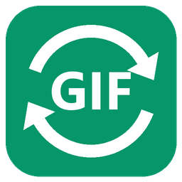
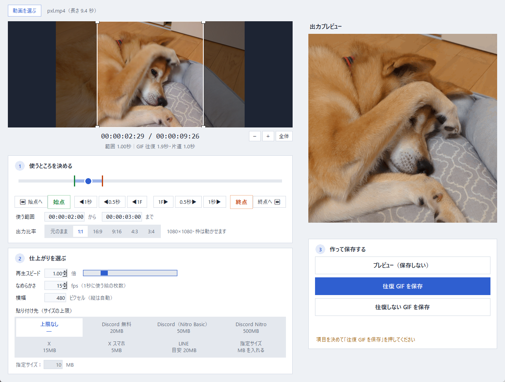

# GIF ループツール



動画（MP4 など）の一部分を、再生と逆再生をつないだ「行って戻る」往復ループの GIF にするアプリです。動画を見ながら範囲と切り抜く場所を決め、Discord や X に貼れる大きさに自動で収めます。できた GIF は、保存する前にその場で画面の中で再生して確かめられます。往復しない（片道で止まる）GIF も作れます。

スマホ版の [くるりん GIF](https://ishi061-svg.github.io/kururin-gif/) と同じ見た目・同じ言葉にそろえています。



## できること
- **動画を入れる**：「動画を選ぶ」ボタンのほか、画面にドラッグ＆ドロップしても入れられます。ファイルを画面の上に持ってくると、枠が青くなって「離すと読み込みます」と出ます
- **画面の並び**：「①使うところを決める」「②仕上がりを選ぶ」「③作って保存する」の3つのカードに分かれています。上から順に進めば GIF ができます
- **範囲を決める**：シークバーの青い丸を動かすと、その位置の絵が出ます。［始点］［終点］ボタンで範囲を決めます。シークバーには、始点が緑、終点がオレンジの縦線で出ます
  - タイムのすぐ下に「範囲 1.00秒｜GIF 往復 1.9秒・片道 1.0秒」のように、範囲の長さとできる GIF の長さが出ます
  - 始点を終点より後ろに置くと、範囲の長さを保ったまま終点もついてきます（終点を始点より前に置いたときは、始点がついてきます）
  - タイムは動画編集ソフトと同じ「時:分:秒:フレーム」（例：00:00:08:09）で表示します。始点・終点の欄には、この形でも秒の数字（例：8.3）でも入れられます
  - ［⏮始点へ］［◀1秒］［◀0.5秒］［◀1F］［1F▶］［0.5秒▶］［1秒▶］［終点へ⏭］ボタンで、始点・終点へ飛んだり、少しずつ動いたりできます
  - キーボードでも動かせます：←→ で1フレーム、Shift＋←→ で1秒
  - シークバーは拡大・縮小できます：Ctrl＋ホイール、または［−］［＋］［全体］ボタン。拡大中は横のスクロールバーやホイールで見る場所を動かせ、いまの位置が外へ出ると自動で追いかけます
- **大きな画面で確かめる**：画面を広げたり最大化したりすると、動画の絵とシークバーが大きくなります
- **切り抜く**：出力比率（元のまま・1:1・16:9・9:16・4:3・3:4）をボタンで選ぶと、動画の上に枠が出ます。枠はドラッグで動かせ、角を引っぱると比率を保ったまま大きさを変えられます
- **サイズ上限に収める**：貼り付け先をタイルから選ぶと、その上限に収まるまで自動で作り直します
  - Discord 無料（20MB）・Discord（Nitro Basic）（50MB）・Discord Nitro（500MB）
  - X（15MB）・X スマホ（5MB）
  - LINE（目安 20MB）
  - 指定サイズ（MB を自分で入れる）
- **そのほかの設定**：横幅、なめらかさ（fps：1秒に使う絵の枚数）、再生スピード。fps と再生スピードは▲▼ボタンでも上下できます
  - 再生スピードは、スライダーで 0.25〜4倍を 0.05倍きざみで細かく決めることもできます
- 対応する形式：MP4・MOV・AVI・MKV・WEBM・M4V（スマホで縦に撮った動画も使えます）
- **作って保存する**：3つのボタンがあります
  - ［プレビュー（保存しない）］：保存せずに作って、右の「出力プレビュー」で再生します
  - ［往復 GIF を保存］：往復ループの GIF を保存します。プレビューのあと設定を変えていなければ、作り直さずにそのまま保存します
  - ［往復しない GIF を保存］：逆再生をつながず、片道を1回だけ再生して最後の絵で止まる GIF を保存します
  - 作っている間は、進み具合のバーと「26%・あと約 3 秒」が出ます。［やめる］で途中で止められます（作りかけの GIF は残しません）
- 元の動画と同じ場所に「元の名前_loop.gif」（往復しない GIF は「元の名前_once.gif」）で保存します。同じ名前があるときは `_loop2` のように番号を付け、上書きしません

※ サイズ上限の数字は、2026年11月に Discord・X の公式の説明などで調べたものです。変わることがあるので、そのときは「指定サイズ」を使ってください。
※ LINE は公式の説明で上限が見つからなかったため、ほかの会社のまとめページにあった 20MB を目安にしています（確かめた数字ではありません）。

## 工夫したところ
- **切れ目のない往復**：折り返し地点で同じ絵が2回続くと一瞬止まって見えるので、逆再生側の最初と最後の1枚を外しています
- **色をきれいに**：GIF は 256 色までしか使えないので、動画ごとに合う色の一覧（パレット）を作ってから保存します
- **サイズに収める作り直し**：大きすぎたら、横幅 → fps の順に下げて作り直します。GIF の大きさが「横幅×高さ」にほぼ比例することを使い、一度で収まりそうな横幅まで下げるので、作り直しが少なくすみます。何を変えたかは画面に表示します
- **X の決まりを守る**：「350枚まで」「1280×1080 まで」に合わせて、作る前に fps と横幅を調整します
- **シークバーが固まらない**：ドラッグ中は絵の取り出しのお願いが何十回も届くので、取り出し中は「最後のお願い」だけを覚えておきます
- **広げても重くならず、枠もずれない**：画面の端を引っぱっている間は今の絵を置き直すだけにし、広げ終わってから1回だけ絵を取り出します。切り抜き枠は「実際に見せている絵の大きさ」から倍率を計算するので、拡大しても位置がずれません
- **プレビューを無駄にしない**：動画とすべての設定をまとめた目印をくらべ、プレビューと同じなら作り直さずに保存します。プレビュー用の GIF はツール専用の一時フォルダに作り、閉じるときに片づけます
- **拡大しても見失わない**：Ctrl＋ホイールでは、マウスの下の時刻が動かないように拡大します。いまの位置が外へ出たときは、進む向きに余白を残して表示を動かすので、1フレームずつ進めても毎回表示が動くことはありません
- **キーボードと入力欄がぶつからない**：始点などの欄に入力している間は、←→ キーを欄の中のカーソル移動に使い、位置は動かしません
- **タイムと絵がずれない**：ffmpeg は「指定した時刻より後ろの、最初の絵」を返すので、計算のわずかな誤差で1フレーム先の絵になることがありました。ほんの少し手前を指定して、表示のタイム・プレビュー・できた GIF の最初の絵がそろうようにしています
- **縦向き動画に対応**：スマホの動画に付いている「90度回して見せる」印を読んで、枠の位置がずれないようにしています
- **すぐ再生できる**：画面で再生する絵は ffmpeg でまとめて取り出します（298 枚の GIF で 33 秒 → 0.6 秒）
- **進み具合が分かる**：ffmpeg は、まず範囲の絵を全部読み込み、そのあと GIF に書きます。1枚ごとに知らせを出す機能（showinfo）を読み込みの直後と書き込みの直前に入れて両方を数え、実際に計った時間の割合（読み込み 3〜4割）から、前半 0〜45%・後半 45〜100% として進み具合と残り時間を出します
- **スマホ版と同じ見た目**：同じ色・同じ言葉・同じ「並んだボタンから選ぶ」形にそろえました。Windows のボタンは枠の色を変えられないので、線の色の枠で包んで、うすい線で囲まれたボタンに見せています
- **分かりやすい案内**：おかしな入力は「どの欄を、どう直せばよいか」をまとめて出します。枚数が多く重くなりそうなときは、続けるかを聞きます

## 使い方
### 必要なもの
- Python 3（3.13 で確かめました）
- [ffmpeg](https://ffmpeg.org/)（動画や音声を扱う道具。`ffmpeg` と `ffprobe` が使える状態にしておきます）
- tkinterdnd2（ドラッグ＆ドロップ用の部品）

```
pip install -r requirements.txt
```

### 起動

```
python app.py
```

### 画面なしで使う

```
python gif_loop.py 動画 [--start 開始秒] [--end 終了秒] [--width 横幅] [--fps fps] [--speed スピード] [--out 保存先]
```

例：`python gif_loop.py 夕焼け.mp4 --start 2 --end 5`

（切り抜きとサイズ上限は、画面からだけ使えます）

### exe にする（Windows）
[PyInstaller](https://pyinstaller.org/) を使うと、ダブルクリックで開ける exe にできます。exe の中に ffmpeg は入らないので、使うパソコンに ffmpeg が必要です。

```
pip install pyinstaller
python -m PyInstaller --onefile --windowed --name gif-loop-tool --collect-all tkinterdnd2 --icon icon.ico --add-data "icon.ico;." app.py
```

アイコン（`icon.ico`）を作り直すときは、Pillow（画像を作る部品）を入れて `python make_icon.py` を動かします。

`dist` フォルダに `gif-loop-tool.exe` ができます。

## ファイル
- `app.py`：画面（動画のプレビュー、シークバーの拡大・縮小と操作ボタン、キーボード操作、切り抜き枠、ドロップの案内、設定、進み具合と［やめる］、出力プレビューの再生）
- `gif_loop.py`：変換する部分（ffmpeg で往復ループ・往復しない GIF を作る、進み具合を数える、サイズ上限に収める、絵を取り出す、タイムの計算）
- `make_icon.py`：アイコンを作るプログラム
- `icon.ico`：アイコン（exe と画面に付ける）
- `requirements.txt`：必要な Python の部品
- `images/screenshot.png`：README の画面写真
- `images/icon.png`：README のアイコンの絵

## 使ったもの
- Python、tkinter、tkinterdnd2、ffmpeg、PyInstaller、Pillow（アイコン作り）
- Claude：1ステップずつ一緒に作り、毎回動かして確かめました
